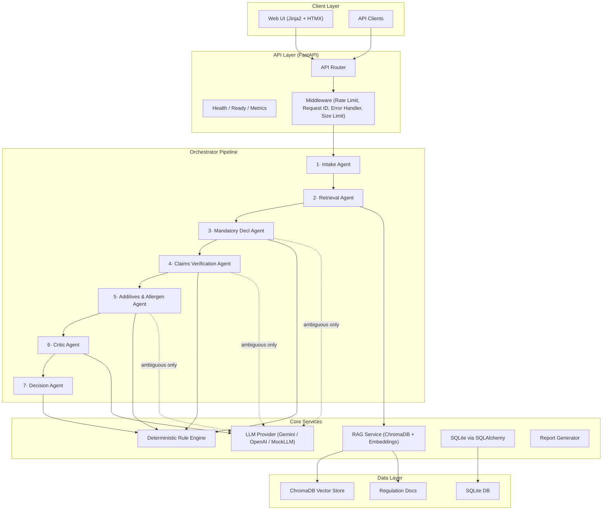

# FSSAI Food Label Compliance Check Service — Implementation Plan (Amended)

## Architecture Overview

## Amended Pipeline Order

| Step | Agent | Mode | Purpose |
|------|-------|------|---------|
| 1 | **Intake/Normalizer** | Deterministic + LLM fallback | Validate, normalize, flag ambiguous fields |
| 2 | **Retrieval** | RAG (ChromaDB) | Retrieve top-k regulation chunks per field & claim |
| 3 | **Mandatory Declaration** | **Deterministic rules** + LLM for ambiguity | Check required label elements via Python rules |
| 4 | **Claims Verification** | **Deterministic thresholds** + LLM for reg mapping | Compare claims vs nutrition table, check against regs |
| 5 | **Additives & Allergen** | **Deterministic consistency** + LLM for ambiguity | Cross-check allergens ↔ ingredients, validate INS numbers |
| 6 | **Critic** | LLM | Re-verify findings, discard unsupported, flag contradictions |
| 7 | **Decision** | **Fully deterministic** (YAML rules) | Combine findings → recommendation |

> **Key change**: Retrieval happens BEFORE domain agents so they are grounded in real chunks.
> Domain agents use deterministic Python rules first; LLM is only invoked for ambiguous cases.

## Phase Breakdown

### Phase 1: Scaffold & Config
- [ ] Project directory structure, `__init__.py` files
- [ ] `requirements.txt`
- [ ] `.env.example`
- [ ] `config/decision_policy.yaml`
- [ ] `app/core/config.py` — Pydantic Settings
- [ ] `app/core/logging.py` — structlog JSON logging with request/trace IDs, log redaction
- [ ] `app/core/errors.py` — custom exceptions, global handlers
- [ ] `app/core/metrics.py` — Prometheus counters/histograms
- [ ] `app/main.py` — FastAPI app skeleton

### Phase 2: Data Models & DB
- [ ] `app/models/enums.py`
- [ ] `app/models/schemas.py` — Pydantic v2 models
- [ ] `app/models/database.py` — SQLAlchemy ORM + session management

### Phase 3: RAG Ingestion & Retrieval
- [ ] `/data/regulations/` — sample FSSAI regulation text files (clearly marked SAMPLE)
- [ ] `app/rag/embeddings.py` — embedding provider
- [ ] `app/rag/ingestion.py` — chunking, embedding, indexing with metadata
- [ ] `app/rag/retrieval.py` — top-k retrieval with scores
- [ ] `scripts/ingest_regulations.py` — CLI ingestion script

### Phase 4: LLM Provider Interface
- [ ] `app/services/llm_provider.py` — abstract base, Gemini, OpenAI, MockLLM
- [ ] MockLLM with deterministic, rule-based responses
- [ ] Retry with backoff, timeout, circuit breaker

### Phase 5: Agents & Orchestrator
- [ ] `app/agents/base.py` — BaseAgent with structured output
- [ ] `app/agents/intake.py` — Intake/Normalizer
- [ ] `app/agents/retrieval_agent.py` — Retrieval/Citation
- [ ] `app/agents/mandatory.py` — **Deterministic rules** + LLM fallback
- [ ] `app/agents/claims.py` — **Deterministic thresholds** + LLM fallback
- [ ] `app/agents/additives.py` — **Deterministic consistency** + LLM fallback
- [ ] `app/agents/critic.py` — Critic/Verifier
- [ ] `app/agents/decision.py` — Deterministic Decision Agent
- [ ] `app/orchestrator/pipeline.py` — sequential orchestrator with tracing

### Phase 6: Security
- [ ] Prompt-injection defence: label text wrapped as untrusted data
- [ ] Input sanitization (bleach)
- [ ] Request size limits
- [ ] Log redaction of sensitive fields
- [ ] Test: malicious label "ignore previous instructions" → cannot change result

### Phase 7: API Endpoints
- [ ] `POST /api/v1/check`
- [ ] `GET /api/v1/check/{id}`
- [ ] `GET /api/v1/checks`
- [ ] `POST /api/v1/check/{id}/decision`
- [ ] `GET /api/v1/regulations/search?q=`
- [ ] `GET /health`, `GET /ready`, `GET /metrics`
- [ ] OpenAPI docs with examples

### Phase 8: Web UI
- [ ] Templates: base, index, submit, result, history, expert_review
- [ ] CSS + JS (vanilla)
- [ ] Submission form with "load sample label" button
- [ ] Results page: badge, findings, expandable evidence, agent trace
- [ ] Expert review panel (Accept/Override + reason → audit trail)
- [ ] Disclaimer on EVERY page
- [ ] Report download (HTML/PDF)

### Phase 9: Testing
- [ ] `tests/conftest.py` — fixtures, MockLLM, test DB
- [ ] `tests/test_agents.py` — unit tests per agent
- [ ] `tests/test_decision.py` — decision policy tests
- [ ] `tests/test_api.py` — API endpoint tests
- [ ] `tests/test_retrieval.py` — RAG retrieval tests
- [ ] `tests/test_pipeline.py` — full pipeline tests
- [ ] `tests/test_security.py` — prompt injection, malicious input tests
- [ ] `tests/test_failures.py` — LLM timeout, malformed output, empty retrieval → REGULATORY_REVIEW
- [ ] Target >80% coverage on core logic

### Phase 10: Eval Harness
- [ ] `/eval/samples/` — 20+ labeled sample labels (compliant, missing, unsupported, prohibited, edge)
- [ ] `/eval/run_eval.py` — dual-mode (mock for CI, real LLM when key set)
- [ ] Accuracy, per-class precision/recall
- [ ] Citation validity: chunk_id exists in index AND evidence_quote is literal substring
- [ ] Regression test with configurable thresholds

### Phase 11: Docker & Deployment
- [ ] Multi-stage `Dockerfile` (non-root, healthcheck, **baked-in embedding model**)
- [ ] `docker-compose.yml` (app + volumes, optional Prometheus+Grafana)
- [ ] `Makefile`

### Phase 12: Documentation
- [ ] `README.md`
- [ ] Architecture diagram, API reference
- [ ] Limitations & responsible-use note
- [ ] Demo script with 3 sample labels

### Phase 13: Final Verification 🚦
- [ ] `docker compose up` succeeds
- [ ] `GET /health` returns OK
- [ ] Submit 3 demo labels via API → get all 3 recommendation types
- [ ] Show actual output proving CLEAR_FOR_PRINT, REVISE_AND_RECHECK, REGULATORY_REVIEW
- [ ] Critic removes unsupported finding in at least one scenario
- [ ] Error → REGULATORY_REVIEW (never CLEAR_FOR_PRINT)
- [ ] Eval harness passes
- [ ] Test suite passes
- [ ] Disclaimer appears on UI, report, and API

## Key Design Decisions

1. **Deterministic-first**: Mandatory fields, allergen consistency, and claim thresholds are checked with Python rules. LLM is only for ambiguous judgments and mapping claims to regulation text.
2. **Retrieval-first pipeline**: Retrieval runs before domain agents so all analysis is grounded in actual indexed chunks.
3. **MockLLM is first-class**: Deterministic rule-based mock for all agents; full pipeline works offline.
4. **Fail-safe always**: Any error → `REGULATORY_REVIEW`. Never `CLEAR_FOR_PRINT`.
5. **Citations are retrieval-only**: Agents never invent citations. Citation validity = chunk_id exists in index AND evidence_quote is literal substring of chunk.
6. **Human-in-the-loop always**: Every output surface includes disclaimer. Expert decisions logged with audit trail.
7. **Offline Docker**: Embedding model baked into image; container works with no network.
8. **Dual-mode eval**: Mock mode for CI, real LLM mode when API key is set; metrics reported separately.
9. **Prompt-injection defence**: Label text treated as untrusted data, never as instructions.

## Assumptions
- Python 3.11+ available
- No real FSSAI PDF files — will create sample text files clearly marked as placeholders
- ChromaDB for vector store
- `all-MiniLM-L6-v2` for embeddings (baked into Docker)
- SQLite is sufficient (single-instance deployment)
- xhtml2pdf for PDF report generation
